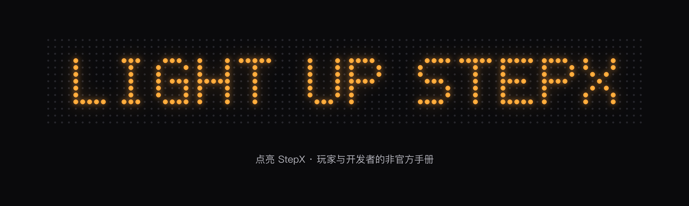

## Light Up StepX · 点亮 StepX

StepX Neo 玩家与开发者的非官方手册。我们把在这台手机上实测过的玩法、开发经验和踩过的坑写下来，把大家想要的能力公开记在一块看板上。

- **手册**：[wetlink/light-up-stepx](https://github.com/wetlink/light-up-stepx)，18 篇文档，从上手、玩机到用 Step Studio 做应用和上架
- **飞书知识库**：[Light Up StepX](https://ncngqg6sl1x7.feishu.cn/wiki/PhtTwhQ5gibjb6kMT2UcKKTDnHb)，同一份内容，适合在手机上读，交流群入口也在首页
- **许愿池看板**：[看大家在许什么愿](https://ncngqg6sl1x7.feishu.cn/wiki/LByNwdOiZiX8Oek9oGucFOXMn6b?table=tblvxYrNgKES9R9U&view=vew3i77ew0)，一句话就能提，谁提的、有没有人认领、官方有没有回应都公开

本项目由玩家和开发者自发维护，与阶跃星辰没有隶属关系。

---

Light Up StepX is an unofficial, community-written handbook for the StepX Neo, the AI phone made by StepFun. The documents are in Chinese for now; issues in English are welcome in [the handbook repo](https://github.com/wetlink/light-up-stepx/issues).
